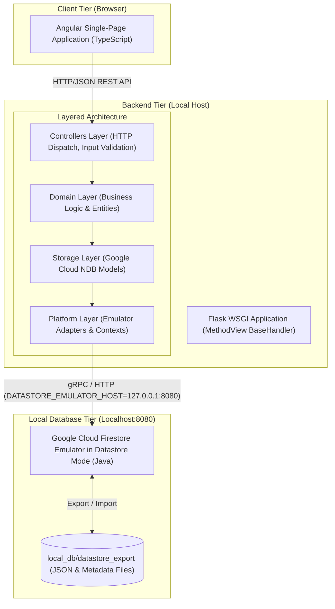
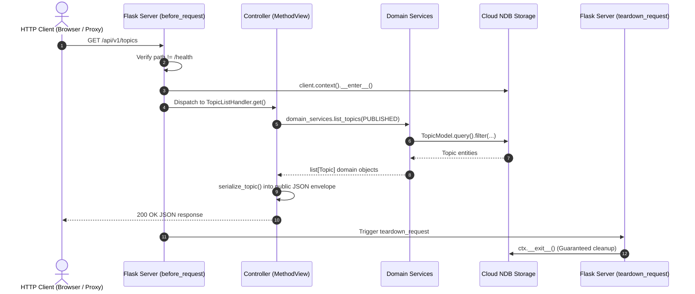

# Architecture Specification

## 1. System Overview & Local Topology

The Digital Health Awareness Web Application is designed for zero-cost, local-only development on native Windows 11. It reproduces key architectural principles from the Oppia Foundation: strict layer separation, class-based HTTP handlers, and a schemaless NoSQL Datastore entity model.

---

## 2. Layered Backend Architecture (Oppia-Inspired)

The backend code is organized into four decoupled layers to ensure testability, maintainability, and alignment with Oppia's open-source architecture:

1. **Controllers Layer (`backend/controllers/`):**
   - Implements request handlers by subclassing a common `BaseHandler` (built atop `flask.views.MethodView`).
   - Dispatches HTTP methods (`get`, `post`, `put`, `delete`).
   - Normalizes and validates incoming query parameters and JSON payloads (`self.payload`).
   - Enforces access control and formats standardized JSON responses (`self.render_json`).
   - Delegates all business logic to the domain services.

2. **Domain Layer (`backend/domain/`):**
   - Contains pure business logic, domain entity classes (`*_domain.py`), and domain service functions (`*_services.py`).
   - Contains zero HTTP or database transport logic.
   - Converts between NDB storage models and clean domain objects.

3. **Storage Layer (`backend/storage/`):**
   - Defines Google Cloud NDB entity classes (`ndb.Model`).
   - Implements indexes, properties, and queries.
   - Encapsulates low-level persistence operations.

4. **Platform Layer (`backend/platform/`):**
   - Manages environment configuration, emulator client context binding (`ndb.Client().context()`), and platform-level services.

---

## 3. Storage Interface: Google Cloud NDB

Google Cloud NDB (`google-cloud-ndb`) provides an object-document mapping interface for Google Cloud Datastore. In our stack:
- **NoSQL Document Storage:** Models health lessons, cards, user progression, and question states without relational table migrations.
- **In-Memory Caching:** Provides automatic context caching and batch operations.
- **Local Compatibility:** Communicates directly with local emulators via gRPC and HTTP without requiring cloud connectivity.

---

## 4. Local Emulator Safety Boundaries

To guarantee that the application runs locally at zero cost and never incurs cloud billing or contacts remote systems:

1. **Loopback Isolation:** The Google Cloud Firestore emulator in Datastore mode binds strictly to `127.0.0.1:8080`.
2. **Environment Redirection:** The backend client requires the `DATASTORE_EMULATOR_HOST=127.0.0.1:8080` environment variable.
3. **Hard Fail Safeguard:** The application client refuses to start if `DATASTORE_EMULATOR_HOST` is unset or points to a non-loopback address.
4. **Zero Cloud Dependencies:** No Google Cloud project registration, API keys, credentials, or billing accounts are required or utilized.

---

## 5. Request Lifecycle & Request-Scoped NDB Contexts

Cloud NDB requires code to execute inside an active `ndb.Client().context()` context manager. To ensure thread safety, isolate transactions, and eliminate memory leaks, the Flask application factory manages contexts on a strict per-request basis:

- **Liveness Exemption:** The process-liveness endpoint (`/api/v1/health`) does not enter an NDB context, ensuring process health checks remain responsive even during storage maintenance.
- **Fail-Safe Release:** `teardown_request` unconditionally exits and releases the thread-local NDB context, even if an unhandled exception is raised during request handling.
- **No Global Context:** No permanent or process-wide global context is ever created.

---

## 6. Frontend Angular Proxy Architecture

To adhere to security best practices and eliminate wildcard CORS headers (`Access-Control-Allow-Origin: *`), the application uses an Angular CLI forward proxy during local development:

- **Browser Origin:** The frontend Angular app serves from `http://127.0.0.1:4200`.
- **API Origin:** The Flask backend serves from `http://127.0.0.1:5000`.
- **Forwarding Rule:** Angular's dev-server proxy configuration intercepts `/api/*` and relays requests locally to port `5000`. To the browser, all API calls are same-origin, completely circumventing CORS preflight requests and ensuring identical behavior to production reverse-proxy deployments (e.g. Nginx).
