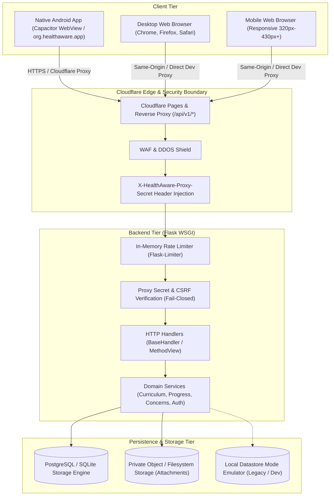

# High-Level Architecture Document (HLD)
## HealthAware Platform — Phase 6B Mobile UX & Systems Architecture

### 1. System Overview & Objectives
HealthAware is an evidence-based preventive health education and community sanitation reporting platform. It is designed to serve citizens, learners, contributors, reviewers, and municipal health staff across both modern desktop/mobile web browsers and native Android devices (via Capacitor).

### 2. Deployment Topology & Environments

### 3. Component Responsibilities & Trust Boundaries

#### 3.1 Client Tier (Angular 22 Standalone + Capacitor 8)
- **Presentation & UI**: Standalone Angular components, responsive layouts, accessible forms.
- **Environment Detection**: Detects native Android vs web platform using `Capacitor.isNativePlatform()` to adjust layout (e.g. hiding the extensive footer in native app, leveraging fixed bottom navigation with safe-area insets).
- **Offline / Local Progress**: LocalStorage cache with merge strategies for cross-device learner progression.
- **Trust Boundary**: The client tier is strictly untrusted. All input validation, role checks, and rate limits are enforced authoritatively on the backend.

#### 3.2 Edge & Proxy Tier (Cloudflare Pages)
- Serves static assets for the web application and proxies `/api/v1/*` requests to the Flask backend.
- Injects `X-HealthAware-Proxy-Secret` to prevent direct unauthenticated backend scraping or bypass.
- Enforces TLS termination and standard edge caching for static assets.

#### 3.3 Backend Application Tier (Flask WSGI)
- **Fail-Closed Proxy Verification**: Validates `X-HealthAware-Proxy-Secret` in production. Liveness and readiness endpoints (`/api/v1/health`, `/api/v1/health/ready`) are exempt for monitoring probes.
- **Session & CSRF**: Double-submit CSRF cookies (`X-XSRF-TOKEN`) for cookie-authenticated sessions; HS256 JWT tokens for learner mobile sessions.
- **Rate Limiting**: Protects citizen report submission, learner registration/login, and password recovery against brute-force abuse.
- **Controllers & Domain Services**: Business rules (concern validation, progress synchronization, user access control) are decoupled from HTTP transport.

#### 3.4 Storage & Media Tier
- **Relational Storage (PostgreSQL / SQLite)**: Stores user accounts, learner progress, concern reports, audit events, and attachment metadata.
- **Private Attachment Storage**: Stores concern evidence images outside the public web root. Images are validated by magic bytes, stripped of EXIF/GPS metadata via Pillow, and referenced via unpredictable UUID storage keys.

### 4. Core System Data Flows

1. **Startup & Warm-up Flow**:
   - Client initializes `BackendWarmupService` upon application launch.
   - Issues a lightweight GET `/api/v1/health/ready` check via Cloudflare proxy.
   - Prefetches public topic list lazily/concurrently with cached replay.
   - Non-blocking: UI renders immediately without waiting for backend spin-up.

2. **Citizen Concern Intake Flow**:
   - Citizen selects category, location, details, and up to 5 photos.
   - Review step renders comprehensive summary of all entered values and image thumbnails.
   - Client sends multipart/form-data to POST `/api/v1/concerns`.
   - Backend validates required fields, validates each image's magic bytes (JPEG/PNG/WebP, max 5MB), strips EXIF metadata, creates `ConcernReportModel` and up to 5 `ConcernAttachmentModel` records in a single database transaction.
   - Returns unique `reference_id` and single-use `tracking_token` to citizen.

3. **Role-Based Authentication & OTP Challenge Flow**:
   - Clear entry points for Learners, Contributors, Reviewers, and Staff.
   - Registration and password reset require email OTP challenge verification before setting password.
   - OTP codes are generated via cryptographically secure random generator, valid for 10 minutes, stored as secure SHA-256 hashes, with bounded attempt counts and cooldown periods.

### 5. Phase 7 — Unified Role-Based Authentication & Account Lifecycle

#### 5.1 Explicit Account States & Transitions

```mermaid
stateDiagram-v2
    [*] --> RegistrationPending: Submit Registration
    
    state RegistrationPending {
        [*] --> EmailChallengePending
        EmailChallengePending --> EmailVerified: Verify Email OTP (6 digits)
        EmailVerified --> MobileChallengePending: Required for Non-Learners
        MobileChallengePending --> MobileVerified: Verify SMS OTP (E.164)
    }

    RegistrationPending --> ActiveLearner: Learner Auto-Activation (Email Verified)
    RegistrationPending --> AwaitingRoleApproval: Non-Learner Pre-Provisioning Complete

    state AwaitingRoleApproval {
        [*] --> UnderReview: Admin Claims / Inspects Credentials
        UnderReview --> NeedsMoreInfo: Admin Requests Details
        NeedsMoreInfo --> UnderReview: Applicant Responds
    }

    AwaitingRoleApproval --> ApprovedAndActive: Administrator Approves Role
    AwaitingRoleApproval --> RejectedOrRevoked: Administrator Rejects (with Reason)

    ApprovedAndActive --> [*]: Active Portal Access (Session / Bearer JWT)
    RejectedOrRevoked --> [*]: Reason Trackable; Eligible for Reapplication
```

1. **Registration Pending Verification**:
   - Learner: Email OTP challenge dispatched.
   - Non-Learner: Dual-channel Email OTP and SMS OTP challenges dispatched.
2. **Contact Verified**:
   - Learner: Email verified -> immediate password setup & activation.
   - Non-Learner: Email and Mobile verified -> applicant sets account password -> pre-provisioned password hash stored securely.
3. **Awaiting Role Approval**:
   - Public registration NEVER grants contributor, reviewer, staff, or admin privileges directly.
   - A `StaffApplicationModel` is created in state `pending_review` with tracking token.
   - Applicant can track status at `/staff/application-status` using Reference ID and Token.
4. **Approved and Active**:
   - Administrator reviews application at `/creator/admin`.
   - On approval: Server creates or activates `UserModel` with the approved role and the pre-provisioned password hash (`must_change_password=False`).
   - Applicant can immediately sign in at `/creator/login` using their username/email and chosen password.
5. **Rejected or Revoked**:
   - Administrator records decision reason. Account remains inactive. Login returns 403 Forbidden with decision reason.

#### 5.2 Multi-Provider SMS Engine (Zero-Cost / Free-Tier Priority)
- **E.164 Strict Normalization**: Standardizes numbers into international format (`+<country><national>`).
- **Free-Tier Provider Adapters**:
  - `TwilioSmsProvider`: Free trial balance with verified caller IDs.
  - `Fast2SmsProvider`: Free tier quick SMS for Indian mobile numbers (`+91`).
  - `DevelopmentSmsProvider`: Deterministic, secure local fallback that hashes tokens and logs masked identifiers without leaking OTP values.
- **Provider Decision Gate**: Operates safely without paid subscriptions.

#### 5.3 Unified Password Recovery Across All Portals
- Shared backend endpoints:
  - `POST /api/v1/auth/recover`: Initiates recovery challenge by username or email. Always returns generic success to prevent account enumeration.
  - `POST /api/v1/auth/reset-password`: Verifies OTP token and updates `password_hash`. Rotates and invalidates challenge token.
- Uniform access:
  - Learner modal (`ha-learner-auth-modal`)
  - Creator & Reviewer login (`/creator/login`)
  - Staff portal (`/staff`)

