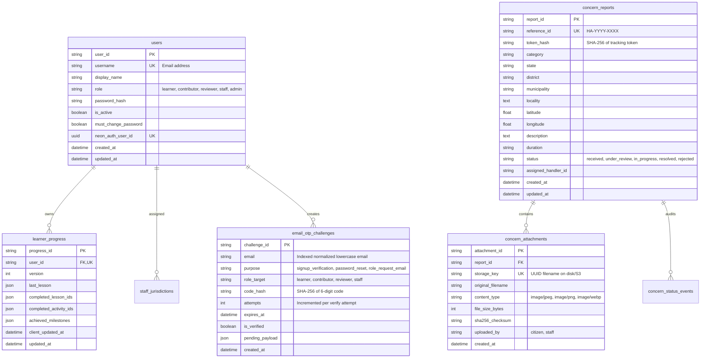

# Low-Level Architecture Document (LLD)
## HealthAware Platform — Core Modules, Contracts & Persistence

### 1. Module Structure & Boundaries

```
backend/
├── app.py                      # Application factory, proxy verification, CORS, error handlers
├── controllers/
│   ├── base.py                 # BaseHandler with render_json & render_error
│   ├── health.py               # HealthCheckHandler (/health), HealthReadinessHandler (/health/ready)
│   ├── topics.py               # Public topic listing and metadata
│   ├── lessons.py              # Public lesson delivery
│   ├── learner.py              # Learner progress sync (/learner/progress)
│   ├── learner_auth.py         # Learner auth, registration, login, OTP challenge
│   ├── concerns.py             # Citizen concern submission (/concerns) and tracking
│   ├── staff.py                # Staff triage, jurisdiction, and resolution handlers
│   └── auth.py                 # Staff / admin session auth and token verification
├── domain/
│   ├── domain_objects.py       # Core domain types (User, Topic, Lesson, UserRole)
│   ├── concern_models.py       # Concern categories, statuses, allowed states
│   └── progress_domain.py      # Learner progress domain model & merge algorithms
├── platform/
│   ├── attachment_storage.py   # AttachmentStorageService: magic bytes, EXIF strip, disk/S3
│   ├── email_service.py        # Transactional email service (Gmail API / SMTP relay)
│   ├── otp_service.py          # Cryptographic OTP token challenge service
│   ├── login_throttle.py       # IP & account brute-force protection
│   └── rate_limiter.py         # Flask-Limiter integration & proxy IP resolution
└── storage/
    ├── db.py                   # SQLAlchemy 2 engine, sessionmaker, ping utility
    ├── postgres_models.py      # Declarative ORM models
    └── concern_repository.py   # Repository for concern persistence and audit trails
```

### 2. Request & Response Contracts

All REST API endpoints conform to standard JSON envelopes:

#### 2.1 Standard Error Envelope
```json
{
  "error": {
    "code": "VALIDATION_ERROR | BAD_REQUEST | UNAUTHORIZED | FORBIDDEN | NOT_FOUND | CONFLICT | SERVICE_UNAVAILABLE | RATE_LIMIT_EXCEEDED",
    "message": "Human-readable description of error."
  }
}
```

#### 2.2 Health Check & Readiness Endpoints
- `GET /api/v1/health` -> `200 OK`: `{"status": "healthy"}`
- `GET /api/v1/health/ready` -> `200 OK`: `{"status": "ready", "database": "connected"}` or `503 Service Unavailable`: `{"error": {"code": "DATABASE_UNAVAILABLE", "message": "..."}}`

#### 2.3 Concern Submission Endpoint (`POST /api/v1/concerns`)
- **Content-Type**: `multipart/form-data`
- **Fields**:
  - `category`: string (Required: `open_drainage`, `garbage_dump`, `stagnant_water`, `sewage_overflow`, `defective_toilets`, `other_sanitation`)
  - `state`: string (Required: `Andhra Pradesh` or `Telangana`)
  - `district`: string (Required, max 100 chars)
  - `municipality`: string (Optional, max 100 chars)
  - `locality`: string (Required, max 500 chars)
  - `description`: string (Required, max 2000 chars)
  - `duration`: string (Required: `less_than_week`, `one_to_two_weeks`, `more_than_two_weeks`, `recurring_chronic`)
  - `latitude`: float string (Optional, -90.0 to 90.0)
  - `longitude`: float string (Optional, -180.0 to 180.0)
  - `photos` / `photo`: file[] (Optional, up to 5 files; JPEG/PNG/WebP, max 5MB each)
- **Response** (`201 Created`):
```json
{
  "message": "Your concern has been received by HealthAware.",
  "notice": "This reference confirms intake by HealthAware...",
  "delivery_notice": "...",
  "email_sent": false,
  "data": {
    "reference_id": "HA-2026-XXXX",
    "tracking_token": "raw_opaque_token_string",
    "status": "received",
    "status_label": "Received",
    "created_at": "2026-10-24T18:00:00Z"
  }
}
```

#### 2.4 OTP Challenge & Verification Contracts (New)
- **Initiate Signup Challenge** (`POST /api/v1/auth/signup/challenge`):
  - Request: `{"email": "user@example.com", "role": "learner | contributor_applicant"}`
  - Response (`200 OK`): `{"message": "Verification code dispatched if account eligible.", "expires_in": 600}`
- **Verify Challenge & Set Password** (`POST /api/v1/auth/signup/verify`):
  - Request: `{"email": "user@example.com", "code": "123456", "password": "...", "name": "..."}`
  - Response (`201 Created`): `{"message": "Account created and verified successfully.", "token": "..."}`
- **Initiate Password Reset** (`POST /api/v1/auth/recovery/challenge`):
  - Request: `{"email": "user@example.com"}`
  - Response (`200 OK`): `{"message": "If an account exists, verification instructions have been sent."}`
- **Verify Reset & Update Password** (`POST /api/v1/auth/recovery/reset`):
  - Request: `{"email": "user@example.com", "code": "123456", "new_password": "..."}`
  - Response (`200 OK`): `{"message": "Password updated successfully."}`

### 3. Data Entities & Relational Schema



### 4. Key Workflows & State Invariants

#### 4.1 Safe Multi-Attachment Concern Pipeline
1. Up to 5 files accepted via `photos` (or legacy `photo`).
2. Client checks each file: <= 5MB, format JPEG/PNG/WebP.
3. Server executes `AttachmentStorageService.store_attachment`:
   - Inspects magic bytes (first 12 bytes).
   - Verifies integrity via Pillow `Image.verify()`.
   - Strips EXIF metadata by re-encoding to RGB/PNG without metadata buffers.
   - Computes SHA-256 checksum and saves to private storage directory under UUID filename.
4. Inserts parent `ConcernReportModel` and all `ConcernAttachmentModel` records within a single database transaction. If any image fails sanitization, the transaction rolls back cleanly.

#### 4.2 Single Chapter Progress Reset
1. Learner clicks "Reset Progress" for a specific chapter in the UI.
2. The client removes that specific `lesson_id` from `completedLessonIds` and removes its bookmark if active.
3. Other completed chapters, badges, and milestones remain untouched.
4. Changes synchronize locally to `localStorage` and trigger an asynchronous delta merge with the backend when authenticated.

#### 4.3 Multi-Step Role Request & Verification Flow (Pure Email-Based)
1. **Initiate Request** (`POST /api/v1/auth/role-request/initiate`):
   - Enforces valid role, minimum 30-char SOP, and required health/learner safety declarations.
   - Dispatches Email OTP challenge via `otp_service.send_challenge_email`.
2. **Verify Email OTP** (`POST /api/v1/auth/role-request/verify-email`):
   - Validates 6-digit email OTP. On match, marks `is_verified=True`.
3. **Complete Registration** (`POST /api/v1/auth/role-request/complete`):
   - Verifies email OTP (or confirms prior verification). Validates password strength (min 8 chars, uppercase, lowercase, number/symbol).
   - Hashes password using bcrypt / pbkdf2_sha256.
   - Creates `StaffApplicationModel` in `pending_review` status with `verification_checklist` containing `email_verified=True` and `pre_provisioned_password_hash`.
   - Generates and returns tracking credentials (`reference_id` and `tracking_token`).
4. **Admin Approval & Activation** (`POST /api/v1/admin/staff-applications/<id>/approve`):
   - Authorized admin reviews application.
   - Server creates/activates `UserModel` with approved role and sets password to `pre_provisioned_password_hash`.
   - `must_change_password` set to `False` since user securely pre-provisioned their password during registration.

#### 4.4 Unified Password Recovery
1. **Recovery Initiation** (`POST /api/v1/auth/recover`):
   - Accepts `identifier` (username or email).
   - Checks `UserModel`. If found, dispatches 6-digit recovery OTP to registered email.
   - Always returns `200 OK` with generic success message to prevent user enumeration.
2. **Password Reset** (`POST /api/v1/auth/reset-password`):
   - Validates OTP against active `email_otp_challenges` record.
   - Validates password complexity.
   - Updates `UserModel.password_hash`.
   - Consumes and invalidates OTP challenge (`is_verified=True`).

