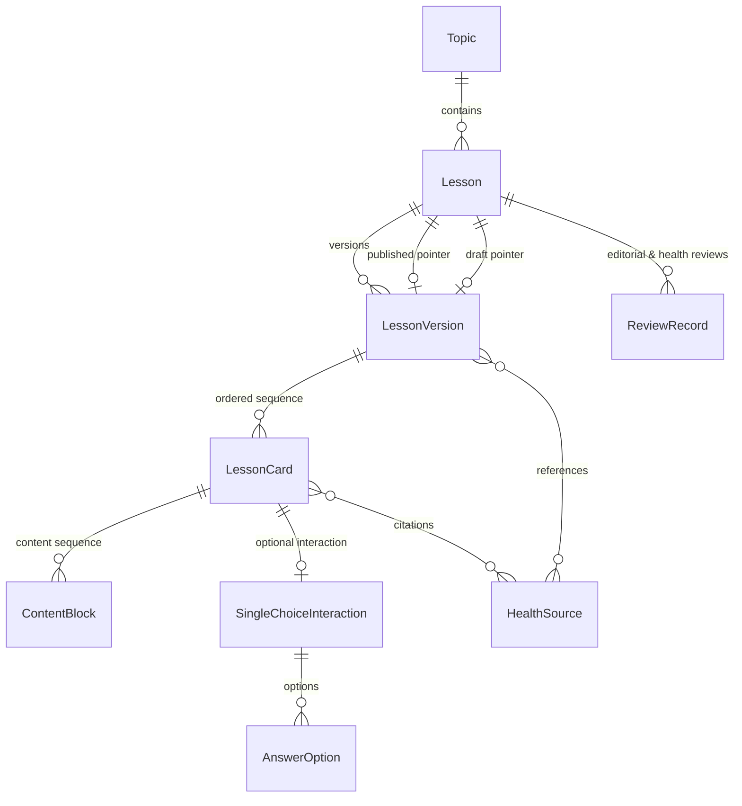
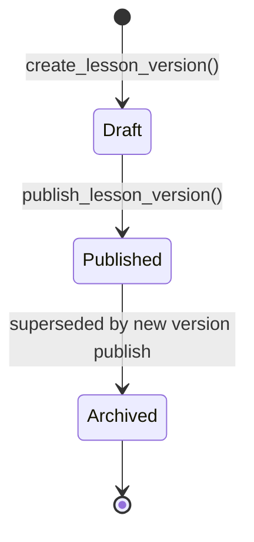

# Data Model Specification

This document defines the domain entities, persistent storage models, validation rules, and relationship topologies for the **Digital Health Awareness Web Application**.

The design adheres to the Oppia-inspired layered architecture:
- **Domain Layer (`backend/domain/`):** Pure Python dataclasses representing business concepts, self-validating, completely decoupled from persistence frameworks.
- **Storage Layer (`backend/storage/`):** Google Cloud NDB (`ndb.Model`) entities optimized for Google Cloud Datastore / Firestore in Datastore mode.
- **Conversion Boundary:** Storage models implement `.to_domain()` and `.from_domain()` methods to keep the domain layer free of persistence semantics.

---

## 1. Entity-Relationship Topology

---

## 2. Core Entities & Schemas

### 2.1 Topic (`Topic` / `TopicModel`)
Represents an overarching health education subject (e.g., *Personal and Food Hygiene*, *Safe Drinking Water*, *Mosquito Prevention*, *Vaccination Awareness*).

- **Key (String ID):** Lowercase hyphen-separated unique slug (e.g., `personal-hygiene`, `safe-water`).
- **Properties:**
  | Field | Type | Storage Property | Constraints |
  |---|---|---|---|
  | `topic_id` | `str` | Key string ID | 3–64 chars, regex `^[a-z0-9][a-z0-9_-]{1,62}[a-z0-9]$` |
  | `title` | `str` | `ndb.StringProperty(required=True)` | Non-empty, max 200 chars |
  | `url_slug` | `str` | `ndb.StringProperty(required=True)` | Lowercase dash-separated slug |
  | `description` | `str` | `ndb.TextProperty(required=True)` | Non-empty, max 1000 chars |
  | `display_order` | `int` | `ndb.IntegerProperty(required=True)` | Integer $\ge 0$ |
  | `status` | `PublicationStatus` | `ndb.StringProperty(choices=['draft', 'published', 'archived'])` | Enum value |
  | `cover_image_ref`| `str?` | `ndb.StringProperty()` | Optional asset URI/path (max 500 chars) |
  | `cover_image_alt`| `str?` | `ndb.StringProperty()` | Optional accessibility text (max 300 chars) |
  | `created_at` | `datetime` | `ndb.DateTimeProperty(auto_now_add=True)` | System timestamp |
  | `updated_at` | `datetime` | `ndb.DateTimeProperty(auto_now=True)` | System timestamp |

---

### 2.2 Lesson Shell (`Lesson` / `LessonModel`)
Acts as a stable container / shell for a lesson within a topic. It decouples references from specific version instances, allowing immutable version history.

- **Key (String ID):** Stable lesson slug (e.g., `hand-washing-technique`, `chlorination-basics`).
- **Properties:**
  | Field | Type | Storage Property | Constraints |
  |---|---|---|---|
  | `lesson_id` | `str` | Key string ID | 3–64 chars, lowercase slug format |
  | `topic_id` | `str` | `ndb.StringProperty(required=True)` | Must reference an existing `Topic` |
  | `display_order` | `int` | `ndb.IntegerProperty(required=True)` | Integer $\ge 0$ |
  | `published_version_id` | `str?` | `ndb.StringProperty()` | References active `LessonVersion` |
  | `draft_version_id` | `str?` | `ndb.StringProperty()` | References pending `LessonVersion` |
  | `created_at` | `datetime` | `ndb.DateTimeProperty(auto_now_add=True)` | System timestamp |
  | `updated_at` | `datetime` | `ndb.DateTimeProperty(auto_now=True)` | System timestamp |

---

### 2.3 Lesson Version (`LessonVersion` / `LessonVersionModel`)
Represents an immutable, content-complete snapshot of a lesson. Contains cards, interactive items, and citations.

- **Key (String ID):** Unique version ID (e.g., `hand-washing-technique-v1`).
- **Properties:**
  | Field | Type | Storage Property | Constraints |
  |---|---|---|---|
  | `version_id` | `str` | Key string ID | Valid ID string |
  | `lesson_id` | `str` | `ndb.StringProperty(required=True)` | Must reference an existing `Lesson` |
  | `version_number`| `int` | `ndb.IntegerProperty(required=True)` | Integer $\ge 1$ |
  | `title` | `str` | `ndb.StringProperty(required=True)` | Non-empty, max 200 chars |
  | `summary` | `str` | `ndb.TextProperty(required=True)` | Non-empty, max 2000 chars |
  | `language` | `str` | `ndb.StringProperty(required=True)` | Supported code: `en`, `hi`, `es`, `fr`, `pt`, `ar`, `sw` |
  | `learning_objectives` | `list[str]` | `ndb.JsonProperty(required=True)` | 1 to 20 items, non-empty |
  | `estimated_duration_minutes` | `int` | `ndb.IntegerProperty(required=True)` | Integer $\ge 1$ |
  | `cards_json` | `list[dict]` | `ndb.JsonProperty(required=True)` | 1 to 100 serialised `LessonCard` objects |
  | `source_ids` | `list[str]` | `ndb.JsonProperty(required=True)` | Up to 50 `HealthSource` ID references |
  | `status` | `VersionStatus` | `ndb.StringProperty(choices=['draft', 'published', 'archived'])` | Version lifecycle state |
  | `created_at` | `datetime` | `ndb.DateTimeProperty(auto_now_add=True)` | System timestamp |
  | `updated_at` | `datetime` | `ndb.DateTimeProperty(auto_now=True)` | System timestamp |

#### Embedded Card Structure (`LessonCard`)
Stored inside `cards_json` to support flexible, hierarchical content without multi-table relational joins:
- `card_id` (`str`): Unique card identifier.
- `position` (`int`): Zero-indexed order within lesson version.
- `card_type` (`CardType`): `explanation`, `interaction`, or `recap`.
- `content_blocks` (`list[ContentBlock]`):
  - `block_type`: `text`, `heading`, or `image_ref`.
  - `body`: UTF-8 markdown or plain string (max 5000 chars).
- `source_ids` (`list[str]`): Sources cited directly on this card.
- `interaction` (`SingleChoiceInteraction?`): Required if `card_type == interaction`, forbidden otherwise:
  - `interaction_type`: `single_choice`.
  - `question_prompt` (`str`): Non-empty prompt.
  - `incorrect_behaviour`: `retry` or `continue`.
  - `options` (`list[AnswerOption]`): 2 to 10 options; exactly 1 must have `is_correct == True`.
    - `option_id` (`str`): Unique ID.
    - `label` (`str`): Answer text.
    - `is_correct` (`bool`): Correctness flag.
    - `feedback` (`str`): Educational explanation displayed upon selection.

---

### 2.4 Health Source & Citation (`HealthSource` / `HealthSourceModel`)
Documents authoritative health evidence sources supporting lesson content, ensuring medical and scientific transparency.

- **Key (String ID):** Source identifier (e.g., `who-hand-hygiene-2024`, `cdc-mosquito-control-2023`).
- **Properties:**
  | Field | Type | Storage Property | Constraints |
  |---|---|---|---|
  | `source_id` | `str` | Key string ID | Valid ID string |
  | `title` | `str` | `ndb.StringProperty(required=True)` | Max 200 chars |
  | `publisher` | `str` | `ndb.StringProperty(required=True)` | Authoritative institution (e.g., WHO, CDC, UNICEF, MoHFW) |
  | `url` | `str` | `ndb.StringProperty(required=True)` | Valid `http://` or `https://` URL |
  | `publication_date`| `date?` | `ndb.DateProperty()` | Date when guidance was issued |
  | `access_date` | `date?` | `ndb.DateProperty()` | Date when team verified the guidance |
  | `jurisdiction` | `str?` | `ndb.StringProperty()` | Global, Regional, or National (max 200 chars) |
  | `metadata_notes` | `str?` | `ndb.TextProperty()` | Context notes (max 1000 chars) |

---

### 2.5 Review Record (`ReviewRecord` / `ReviewRecordModel`)
Tracks peer review and medical verification before publication.

- **Key (String ID):** Review record identifier (e.g., `rev-2025-06-001`).
- **Properties:**
  | Field | Type | Storage Property | Constraints |
  |---|---|---|---|
  | `review_id` | `str` | Key string ID | Valid ID string |
  | `lesson_id` | `str` | `ndb.StringProperty(required=True)` | Lesson being reviewed |
  | `version_id` | `str` | `ndb.StringProperty(required=True)` | Specific version reviewed |
  | `editorial_status` | `ReviewStatus` | `ndb.StringProperty(choices=['pending', 'approved', 'changes_requested'])` | Editorial review state |
  | `health_content_status` | `ReviewStatus` | `ndb.StringProperty(choices=['pending', 'approved', 'changes_requested'])` | Medical accuracy state |
  | `reviewer_role` | `ReviewerRole` | `ndb.StringProperty(choices=['editorial', 'health_content'])` | Role of submitter |
  | `review_date` | `date` | `ndb.DateProperty(required=True)` | Date review performed |
  | `next_review_date` | `date?` | `ndb.DateProperty()` | Scheduled re-verification date |
  | `notes` | `str?` | `ndb.TextProperty()` | Evaluator notes |

---

## 3. Publication Lifecycle & Versioning Workflow

1. **Authoring (Draft Creation):**
   - New version created with status `DRAFT`.
   - Parent `Lesson` updates `draft_version_id = version.version_id`.
2. **Review & Validation:**
   - Review records are filed by editorial and health professionals.
   - Domain validation confirms card ordering, objectives, and single correct answer requirement.
3. **Publication:**
   - Atomic or sequential transition in domain service:
     - Version status set to `PUBLISHED`.
     - Parent `Lesson.published_version_id` points to the newly published version.
     - Any previously published version for the lesson is transitioned to `ARCHIVED`.
     - Parent `Lesson.draft_version_id` is cleared.

---

## 4. Query Patterns & Indexing

The storage layer relies on the following query access patterns verified against the local emulator:

1. **Topics by Status & Display Order:**
   - `TopicModel.query().filter(TopicModel.status == status).order(TopicModel.display_order)`
2. **Lessons by Topic:**
   - `LessonModel.query().filter(LessonModel.topic_id == topic_id).order(LessonModel.display_order)`
3. **Reviews by Lesson:**
   - `ReviewRecordModel.query().filter(ReviewRecordModel.lesson_id == lesson_id)`
4. **Primary Key Lookups:**
   - Direct `Model.get_by_id(id)` with fast memory context resolution.
